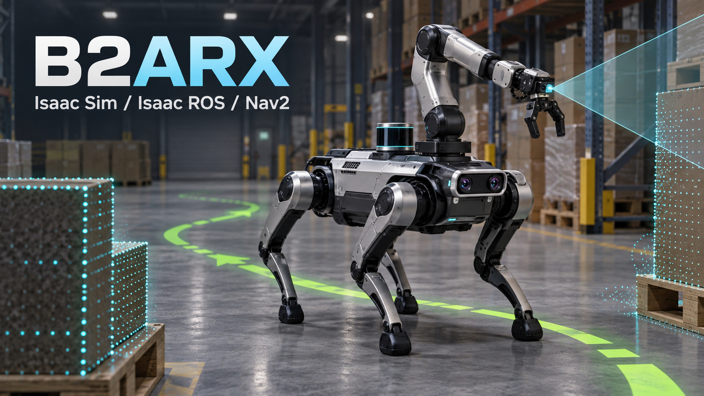

# Policy Models




*AI-generated project concept illustration.*

Each deployable policy lives in its own directory and contains the complete
runtime bundle:

```text
<model-name>/
  basic_locomotion_model.pt  Training checkpoint retained for provenance
  exported/policy_full.onnx  Runtime inference graph
  params/deploy.yaml         Observation/action and control contract
  bundle_manifest.txt        Paths and SHA-256 verification values
```

`basic_locomotion/` is the checked-in baseline used by Nav2. Model binaries are
stored with Git LFS, so clone with `git lfs pull` before running a profile that
references them.

To add another model, export its ONNX and deploy YAML from the training
workspace, place all four files in a new directory here, generate a manifest
with the new SHA-256 values, then copy `config/policies/basic_locomotion.yaml`
and update its relative paths and motion limits. Start it with:

```bash
"$ISAACLAB_ROOT/isaaclab.sh" -p scripts/isaac_b2arx_scene.py \
  --nav2 --deploy_config config/policies/<new-model>.yaml
```
